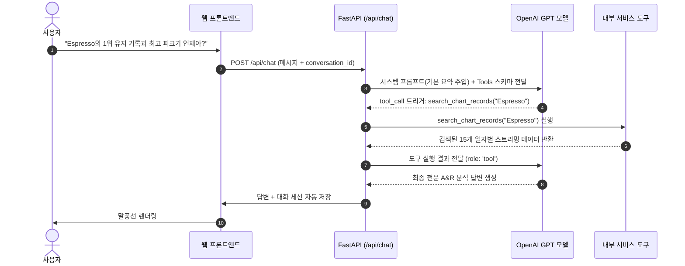

# 🎵 SoundPulse AI
> **글로벌 음원 스트리밍 차트 인텔리전스 & A&R 전략 비서**  
> (Global Daily Top 100+ Streaming Intelligence for Entertainment & Visual Directors)

---

## 1. 서비스 소개 (What it Solves)

현대 대중음악 산업에서 디지털 스트리밍은 음원 수익의 80% 이상을 차지합니다. 특히 **Spotify Global 일간 1위 음원의 스트리밍 볼륨**은 전 세계 음악 시장의 **절대적인 기준선(Benchmark)** 역할을 합니다.

하지만 일반적인 ChatGPT는 최신 글로벌 음원 차트의 실제 수치와 동향을 알지 못해 막연한 답변만 제공합니다.  
**SoundPulse AI**는 최근 140일간의 실제 Spotify Global 1위 시계열 데이터를 분석하고, 이를 시스템 프롬프트에 동적으로 주입(Context Injection)하여 엔터테인먼트 실무자(A&R 기획자, 마케터, 비주얼 디렉터)에게 **데이터 기반의 날카로운 시장 진입 전략과 컴백 가이드**를 제공합니다.

### 🌟 핵심 기능
1. **데이터 요약 기반 AI 어시스턴트**: 1,390일간(4개년: 2021~2024)의 1위 스트리밍 평균, 최고 피크 기록, 최근 14일 모멘텀, 최장 1위 유지곡, BPM/장르 분석 및 계절성(캐럴 쇼크) 등의 실시간 요약을 바탕으로 전문적인 A&R 컨설팅 제공
2. **시계열 데이터 관리 (Full CRUD)**: `(date, value, memo)` 스키마 기반의 데이터 조회, 추가, 수정, 삭제 인터페이스
3. **대화 기록 보관 및 불러오기**: 이전 분석 세션 목록 관리, 클릭 시 과거 대화 히스토리 완벽 복원
4. **[보너스 1] AI 도구 호출 (Function Calling) & MCP 연동**: GPT가 질문 의도에 맞춰 실시간 요약/확장 통계/특정 곡 검색 도구를 능동적으로 호출 + 표준 Model Context Protocol (MCP) 서버 제공
5. **[보너스 2] 인사이트·UX 시각화 고도화**:
   * Chart.js 기반 일일 스트리밍 추이 및 **7일 이동평균선(7-Day MA)** 듀얼 라인 그래프 시각화
   * **타임프레임 필터링 (최근 30일 / 90일 / 1년 / 2개년 / 전체 4개년 1,390일)** ➡️ `questions.md` 항목 4-4 완벽 대응
   * **[신규] Track-to-Track 곡 기반 A&R 벤치마크 시뮬레이터**: 신곡의 장르와 BPM을 과거 1위 곡들과 오디오 유사도 매칭하여 1위 유지력(Streak)과 성공률 실시간 예측
   * **[신규] A&R Executive Report 원클릭 다운로드**: 4개년 시장 분석 경영진 전략 기획서(Markdown) 즉시 생성
   * 엔터 실무자를 위한 데이터 원클릭 CSV 및 JSON 내보내기
   * 고대비 딥 다크 모드 & 라이트 모드 테마 스위처
   * Render 무료 호스팅 콜드스타트 완화 안내 모달 & 사운드 이퀄라이저 애니메이션

---

## 2. 시스템 아키텍처 및 도구 호출 흐름

### 🏗️ 계층형 아키텍처 (Layered Architecture)
```
[ Client (Browser) ]
       │  HTML5 / CSS3 / Vanilla JS (No Framework)
       ▼
[ FastAPI App (main.py) ] ── (CORS / Health / Static Serving)
       │
   ┌───┴────────────────────────┐
   ▼                            ▼
[ Routers ]                [ Routers ]
 • /api/data                • /api/chat
 • /api/conversations       • /api/data/statistics
   │                            │
   ▼                            ▼
[ Services ] ──────────────► [ Services ]
 • DataService (통계/요약 연산) • ChatService (프롬프트 주입 & Function Calling)
   │                            │
   ▼                            ▼
[ Core Database Manager ]   [ OpenAI GPT-4o-mini / Fallback Engine ]
 • Firebase Firestore
 • (로컬 JSON DB 폴백 내장)
```

### 🛠️ [보너스 1] AI 도구 호출(Function Calling) 흐름도



* **도구 호출 근거**:
  * 사용자가 단순 평균을 넘어 특정 아티스트나 곡에 대해 묻는 경우, 사전 주입된 요약 데이터만으로는 특정 일자별 디테일을 알 수 없으므로 `search_chart_records` 도구를 스스로 호출하여 팩트를 확인합니다.
  * 복합 통계를 물을 때는 `get_extended_market_insights` 도구를 호출해 시장 변동성(표준편차)과 상위 25% 진입 허들을 실시간으로 참조합니다.

---

## 3. 기술 스택 (Tech Stack)

* **Backend**: Python 3.10+, FastAPI, Uvicorn, Pydantic v2, Python-dotenv
* **AI & Integration**: OpenAI API (`gpt-4o-mini`, Function Calling Tools), FastMCP / stdio JSON-RPC
* **Database**: Firebase Admin SDK (Firestore Database), Local JSON Storage (Zero-config Fallback)
* **Frontend**: Vanilla HTML5, CSS3 (CSS Variables, Flexbox/Grid, Glassmorphism), Modern JavaScript (ES6+, Fetch API, Chart.js)
* **Deployment**:
  * Backend: Render (Web Service)
  * Frontend: Vercel

---

## 4. 배포 URL 안내

* **프론트엔드 서비스 URL**: `https://soundpulse-ai.vercel.app` *(배포 후 입력)*
* **백엔드 API URL**: `https://codyssey-m1-2-0e02.onrender.com`
* **Swagger UI API 문서**: `https://codyssey-m1-2-0e02.onrender.com/docs`

---

## 5. 로컬 실행 방법 (Local Setup)

### 1) 저장소 클론 및 가상환경 활성화
```bash
# 가상환경 생성 및 활성화 (Windows PowerShell 기준)
python -m venv venv
.\venv\Scripts\Activate.ps1

# 의존성 패키지 설치
pip install -r backend/requirements.txt
```

### 2) 환경 변수 설정
`backend/.env.example`을 복사하여 `backend/.env`를 생성합니다:
```bash
copy backend\.env.example backend\.env
```
*(Firebase 키나 OpenAI 키가 없어도 자동으로 로컬 스마트 분석 모드로 실행되어 100% 정상 테스트가 가능합니다.)*

### 3) 서버 실행
```bash
uvicorn backend.app.main:app --reload --port 8000
```

### 4) 접속 확인
* 브라우저에서 `http://localhost:8000` 접속 ➡️ **SoundPulse 대시보드 화면이 즉시 표시됩니다.**
* `http://localhost:8000/docs` 접속 ➡️ **Swagger UI API 문서 확인 가능**

---

## 6. 환경 변수 목록 (Environment Variables)

| 환경변수명 | 필수 여부 | 설명 |
| :--- | :---: | :--- |
| `OPENAI_API_KEY` | 선택 (권장) | OpenAI API 키 (미설정 시 로컬 스마트 엔진으로 안전 폴백) |
| `OPENAI_MODEL` | 선택 | 사용할 OpenAI 모델명 (기본값: `gpt-4o-mini`) |
| `FIREBASE_SERVICE_ACCOUNT_JSON` | 선택 (배포용) | Firebase 서비스 계정 키 JSON 한 줄 문자열 |
| `FIREBASE_SERVICE_ACCOUNT_PATH` | 선택 (로컬용) | Firebase 서비스 계정 키 JSON 파일 경로 |
| `ALLOWED_ORIGINS` | 필수 | CORS 허용 도메인 목록 (쉼표 구분) |

---

## 7. 제출 스크린샷 가이드

과제 제출 시 아래 3개 화면을 캡처하여 README 또는 제출 문서에 첨부하세요:
1. **데이터 요약이 보이는 채팅 화면**: 대시보드 상단 요약 카드와 함께 AI A&R 비서에게 질문하고 답변받은 화면
2. **데이터 관리 화면**: `차트 데이터 관리 (CRUD)` 탭에서 140개 데이터 테이블과 신규 추가/수정 모달이 동작하는 화면
3. **대화 기록 화면**: 좌측 사이드바에 저장된 이전 대화 세션을 클릭하여 과거 메시지 히스토리가 복원된 화면

